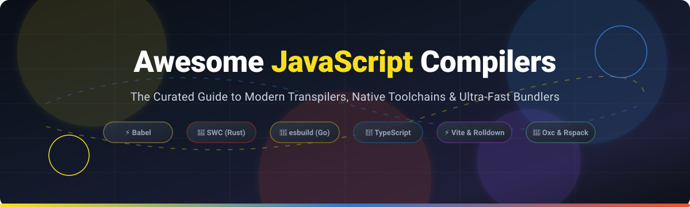

<p align="center">
  
</p>

# 🚀 Awesome JavaScript Compilers ⚡

<p align="center">
  <a href="https://github.com/ishandutta2007/Awesome-Awesome-Awesome"></a>
  <a href="https://discord.gg/jc4xtF58Ve"></a>
  <a href="https://github.com/ishandutta2007/Awesome-Javascript-Compilers/stargazers"></a>
  <a href="https://github.com/ishandutta2007/Awesome-Javascript-Compilers/network/members"></a>
  <a href="https://github.com/ishandutta2007/Awesome-Javascript-Compilers/blob/main/LICENSE"></a>
  <a href="https://github.com/ishandutta2007"></a>
</p>

---

## 🧭 Curated Directory of JavaScript Compilers, Transpilers & Modern Build Toolchains

> **Comprehensive SEO Guide & Curated Developer Resources** for modern syntax transformation, Rust & Go-powered native bundlers, TypeScript type checkers, AST tooling, and cloud edge deployment pipelines.

Whether you're developing high-throughput web applications with Next.js, building ultra-lean NPM libraries with Rollup, or seeking sub-millisecond build performance with Rust-based engines like SWC and Oxc, this directory benchmarks and catalogs top **open-source compilers** and **cloud build platforms**.

---

## 📑 Table of Contents

- [📊 Sector Overview & Market Dynamics](#-sector-overview--market-dynamics)
- [☁️ SaaS & Hosted Build Platforms](#-saas--hosted-build-platforms)
- [📦 Open-Source Compilers & Bundlers](#-open-source-compilers--bundlers)
  - [1. TypeScript Compiler (tsc)](#1-typescript-compiler-tsc)
  - [2. Vite](#2-vite)
  - [3. Webpack](#3-webpack)
  - [4. Babel](#4-babel)
  - [5. Parcel](#5-parcel)
  - [6. esbuild](#6-esbuild)
  - [7. SWC](#7-swc)
  - [8. Turbopack](#8-turbopack)
  - [9. Rollup](#9-rollup)
  - [10. Oxc](#10-oxc)
  - [11. Rolldown](#11-rolldown)
  - [12. Rspack](#12-rspack)
  - [13. tsx](#13-tsx)
  - [14. tsup](#14-tsup)
  - [15. Terser](#15-terser)
  - [16. Closure Compiler](#16-closure-compiler)
  - [17. Sucrase](#17-sucrase)
- [🛠️ Toolchain Selection Guide](#️-toolchain-selection-guide)
- [🤝 How to Contribute](#-how-to-contribute)
- [💖 Support & Sponsorship](#-support--sponsorship)
- [📈 Star History](#-star-history)
- [⚖️ Disclaimer](#️-disclaimer)

---

## 📊 Sector Overview & Market Dynamics

The global web development and Jamstack application deployment market is estimated at **$1.4B to $3.8B** (scaling toward **$80B+** across the broader web application development and cloud hosting industry). The sector is **moderately concentrated at the core deployment infrastructure layer** (dominated by an oligopoly led by Cloudflare, Vercel, and Netlify), while remaining **highly fragmented across compilation toolchains, framework runtimes, and headless CMS integrations**.

---

## ☁️ SaaS & Hosted Build Platforms

> *Note: While low-level JavaScript compilers (like Babel, SWC, esbuild, and tsc) run locally or inside CI/CD environments as open-source engines, hosted cloud build & edge deployment platforms provide managed pipelines that run, transpile, bundle, and serve compiled JavaScript at global scale.*

| Product | Valuation / Revenue | Starting Price | Free Tier Limits | Description |
| :--- | :--- | :--- | :--- | :--- |
| **[Cloudflare Pages](https://pages.cloudflare.com/)** | **$105B – $115B** Market Cap (~$2.51B TTM Revenue) | **$5/month** (Workers Paid plan for higher build/SSR limits) | Free forever: 500 builds/month, 1 concurrent build, unlimited bandwidth, 100 projects, 100k requests/day for Pages Functions (10ms CPU time/request). | Edge-first deployment & hosting engine that executes build commands and serves compiled assets via Cloudflare's global CDN. |
| **[Vercel](https://vercel.com/)** | **$9.3B** Valuation (~$200M ARR) | **$20/user/month** (Pro plan) | Free forever (Hobby Plan): 100 GB fast data transfer, 100 deployments/day, 1 concurrent build, 45 min build time, 1M edge function invocations/month. Non-commercial use. | Creator of Next.js and Turbopack; provides managed deployment and edge infrastructure natively executing modern JS/TS build pipelines. |
| **[Netlify](https://www.netlify.com/)** | **$2.0B** Valuation (~$45M ARR) | **$9/month** (Personal plan; Pro starts at $20/month) | Free forever (Starter): 300 unified credits/month (~15 GB bandwidth / deployment minutes; hard cap with site pausing), 1-day log/analytics retention. Commercial use permitted. | Cloud platform for automated Git-integrated builds, serverless edge functions, and compiled front-end asset delivery. |
| **[Render](https://render.com/)** | **$1.5B** Valuation (~$23.4M ARR) | **$25/month** (Pro workspace flat fee) | Free forever (Hobby Plan): 750 free instance hours/month, 512 MB RAM / 0.1 CPU, 5 GB bandwidth/month; web services spin down after 15 min inactivity; free DBs expire after 30 days. | Unified cloud platform hosting static sites, Node.js runtimes, and full-stack web applications with automated GitHub builds. |

---

## 📦 Open-Source Compilers & Bundlers

All open-source tools below are ranked in descending order by community GitHub_Stars.

### 1. [TypeScript Compiler (tsc)](https://github.com/microsoft/TypeScript) [](https://github.com/microsoft/TypeScript/stargazers)
* **Category**: Static Type Checker & Native Compiler
* **Tech**: C++ / Go Native Port / JavaScript
* **Summary**: The industry type-checking foundation. While Babel, SWC, and esbuild strip types without verifying semantic correctness, `tsc` validates types and creates definitions (`.d.ts`). Best used for type validation across all environments.

### 2. [Vite](https://github.com/vitejs/vite) [](https://github.com/vitejs/vite/stargazers)
* **Category**: Modern Frontend Build Tool & Dev Server
* **Tech**: Node.js / esbuild / Rolldown / Rollup
* **Summary**: Next-generation frontend tooling providing lightning-fast Hot Module Replacement (HMR) powered by native ESM. Orchestrates fast pre-bundling with esbuild and production optimization via Rollup / Rolldown.

### 3. [Webpack](https://github.com/webpack/webpack) [](https://github.com/webpack/webpack/stargazers)
* **Category**: Enterprise Module Bundler & Asset Pipeline
* **Tech**: JavaScript / Node.js
* **Summary**: The battle-tested cornerstone of modern web applications. Excels in complex enterprise environments requiring extensive loader chains, custom AST plugins, code splitting, and Module Federation.

### 4. [Babel](https://github.com/babel/babel) [](https://github.com/babel/babel/stargazers)
* **Category**: JavaScript Transpiler & AST Transformer
* **Tech**: JavaScript
* **Summary**: The gold standard for syntactic transformation and custom AST plugins. Babel 8 is ESM-only and defaults to modern ES specifications. Ideal for legacy polyfilling and experimental syntax transforms.

### 5. [Parcel](https://github.com/parcel-bundler/parcel) [](https://github.com/parcel-bundler/parcel/stargazers)
* **Category**: Zero-Configuration Application Bundler
* **Tech**: Rust (SWC core) / JavaScript
* **Summary**: Zero-config compilation combining out-of-the-box asset bundling (HTML, CSS, JS, images) with native SWC transforms for rapid prototyping and micro-apps.

### 6. [esbuild](https://github.com/evanw/esbuild) [](https://github.com/evanw/esbuild/stargazers)
* **Category**: Ultra-Fast Go-Based Bundler & Minifier
* **Tech**: Go
* **Summary**: Ultra-fast build engine compiling 10x-100x faster than traditional JS-based compilers. Serves as the core compilation layer for Vite's dev dependency pre-bundling and tsup.

### 7. [SWC](https://github.com/swc-project/swc) [](https://github.com/swc-project/swc/stargazers)
* **Category**: High-Performance Rust Compiler & Transpiler
* **Tech**: Rust
* **Summary**: Rust-based extensible platform for compilation and bundling. Serves as a high-speed drop-in replacement for Babel and powers Next.js, Parcel, and Deno's native compiler pipelines.

### 8. [Turbopack](https://github.com/vercel/turbo) [](https://github.com/vercel/turbo/stargazers)
* **Category**: Incremental Rust Bundler & Turbo Engine
* **Tech**: Rust
* **Summary**: Vercel's high-performance incremental bundler engineered with function-level caching. The standard default bundler powering Next.js applications for both local development and production.

### 9. [Rollup](https://github.com/rollup/rollup) [](https://github.com/rollup/rollup/stargazers)
* **Category**: Next-Gen ES Module Bundler
* **Tech**: JavaScript / WebAssembly
* **Summary**: The industry standard for packaging JavaScript libraries. Renowned for generating the cleanest, most efficient tree-shaken ESM and CommonJS bundles.

### 10. [Oxc](https://github.com/oxc-project/oxc) [](https://github.com/oxc-project/oxc/stargazers)
* **Category**: The JavaScript Oxidation Compiler Suite
* **Tech**: Rust
* **Summary**: A collection of high-performance tools written in Rust, including an ultra-fast parser, AST transformer, linter, minifier, and type-stripping compiler built to power modern web tooling.

### 11. [Rolldown](https://github.com/rolldown/rolldown) [](https://github.com/rolldown/rolldown/stargazers)
* **Category**: Rust-Based Rollup Replacement
* **Tech**: Rust / Oxc
* **Summary**: A Rust port of Rollup with Rollup-compatible APIs and plugins, designed to serve as the unified dev and build engine inside upcoming Vite releases.

### 12. [Rspack](https://github.com/web-infra-dev/rspack) [](https://github.com/web-infra-dev/rspack/stargazers)
* **Category**: High-Performance Webpack-Compatible Bundler
* **Tech**: Rust
* **Summary**: Rust-based bundler offering seamless drop-in compatibility with the Webpack ecosystem (loaders, plugins) while delivering 5x to 10x faster build speeds.

### 13. [tsx](https://github.com/privatenumber/tsx) [](https://github.com/privatenumber/tsx/stargazers)
* **Category**: TypeScript Execution Runtime
* **Tech**: TypeScript / esbuild
* **Summary**: The fastest zero-config TypeScript and ESM runtime CLI for Node.js, powered transparently by esbuild for instantaneous script execution.

### 14. [tsup](https://github.com/egoist/tsup) [](https://github.com/egoist/tsup/stargazers)
* **Category**: Zero-Config TypeScript Library Bundler
* **Tech**: TypeScript / esbuild
* **Summary**: Bundle TypeScript libraries with zero configuration. Emits ESM, CJS, and `.d.ts` declaration files automatically at esbuild-grade speeds.

### 15. [Terser](https://github.com/terser/terser) [](https://github.com/terser/terser/stargazers)
* **Category**: JavaScript Parser, Mangler & Minifier
* **Tech**: JavaScript
* **Summary**: The classic production minification toolkit for ES6+. Performs dead-code elimination, variable mangling, and AST compression across modern pipelines.

### 16. [Closure Compiler](https://github.com/google/closure-compiler) [](https://github.com/google/closure-compiler/stargazers)
* **Category**: Whole-Program Optimizing Compiler
* **Tech**: Java
* **Summary**: Google's whole-program optimizing compiler that parses JavaScript, analyzes it, removes dead code, and rewrites code for maximum minification and execution efficiency.

### 17. [Sucrase](https://github.com/alangpierce/sucrase) [](https://github.com/alangpierce/sucrase/stargazers)
* **Category**: Lightweight Modern JavaScript Transpiler
* **Tech**: TypeScript / JavaScript
* **Summary**: Super-fast transpiler targeting modern runtimes by stripping TypeScript and JSX syntax without performing heavy legacy transformations or type verification.

---

## 🛠️ Toolchain Selection Guide

```
Is type safety validation needed?
  ├── Yes ──> Always run tsc --noEmit (paired with fast transpiler)
  └── No  ──> Use Rust/Go native tools below

What is your primary compilation / bundling objective?
  ├── Full Web App (React / Vue / Svelte)
  │     ├── Greenfield / Standard  ──> Vite (dev) + Rolldown (prod)
  │     ├── Next.js Application    ──> Turbopack
  │     └── Large Legacy Webpack   ──> Rspack (Rust-based drop-in)
  ├── NPM Library Distribution     ──> Rollup or tsup
  ├── CLI Scripts & Dev Workflows  ──> tsx (instant execution)
  └── Custom Tooling / Compiler AST──> SWC or Oxc (Rust) / esbuild (Go)
```

---

## 🤝 How to Contribute

Contributions are warmly encouraged! Follow these steps:

1. 🍴 **Fork** the repository.
2. 🌿 Create a feature branch: `git checkout -b feature/new-compiler`.
3. 📝 Add your entry ensuring factual data, repo Stars_Badges (`style=social&color=white`), and official documentation links.
4. 🚀 Open a **Pull Request** describing your additions.

---

## 💖 Support & Sponsorship

If you find this curated ecosystem directory helpful in navigating JavaScript build toolchains, please consider supporting the project:

- ⭐ **Star** this repository to help other developers find it.
- 🍴 **Fork** and contribute new toolchain benchmarks.
- 📢 **Share** with your engineering team and developer communities.
- ☕ **Buy me a coffee**: Support open-source curation and maintenance via the **[GitHub Sponsors Dashboard](https://github.com/sponsors/ishandutta2007)**.

---

## 📈 Star History

[](https://star-history.dera.page/#ishandutta2007/Awesome-Javascript-Compilers&type=date&legend=top-left)

---

## ⚖️ Disclaimer

- This is a community-curated, non-commercial research directory.
- **Compiler vs. Bundler**: Single-file transpilers (Babel, SWC, esbuild, tsc, Sucrase) differ from module bundlers (Vite, Webpack, Rollup, Turbopack, Rspack).
- **Type Checking**: High-speed native compilers strip TypeScript types without checking semantic correctness; always pair them with `tsc --noEmit` in CI.
